  

<!-- ACTIVITY (hidden): delete this line and the "END ACTIVITY" line to show it again

<h3 align="center">IV. &nbsp;Activity</h3>

  
  

  

  

  <picture>
    <source media="(prefers-color-scheme: dark)" srcset="https://raw.githubusercontent.com/KatoPan625/KatoPan625/output/github-snake-dark.svg" />
    <source media="(prefers-color-scheme: light)" srcset="https://raw.githubusercontent.com/KatoPan625/KatoPan625/output/github-snake.svg" />
    
  </picture>

END ACTIVITY -->
